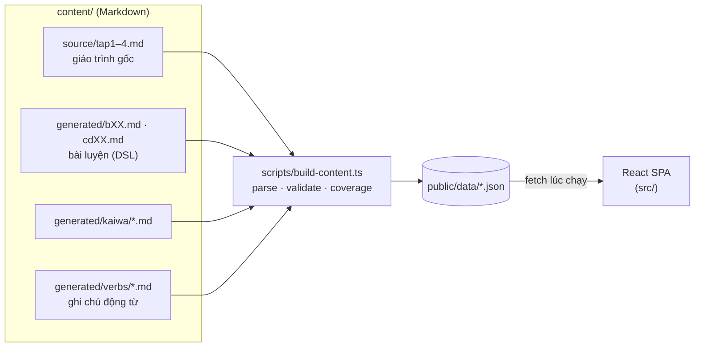

<div align="center">


# Nihongo · N5 → N4

**Ứng dụng web tự học tiếng Nhật theo giáo trình _できる日本語_ (Bài 1–11 · Chủ đề 0–9)**
Lý thuyết · Thẻ ghi nhớ · Ngữ pháp · Viết · Đọc hiểu · Nghe · Hội thoại · Kaiwa · Kiểm tra

[](https://github.com/minhmq2244/nihon-go/actions/workflows/ci.yml)


[Tính năng](#-tính-năng) ·
[Bắt đầu nhanh](#-bắt-đầu-nhanh) ·
[Kiến trúc](#-kiến-trúc) ·
[Nội dung](#-quy-trình-nội-dung) ·
[Triển khai](#-triển-khai) ·
[Đóng góp](#-đóng-góp)

</div>

---

## 📌 Tổng quan

Nihongo là một **SPA chạy hoàn toàn phía trình duyệt**, biến bộ giáo trình _できる日本語_ (Tập 1–4) thành lộ trình luyện tập tương tác cho người Việt học từ N5 lên N4. Toàn bộ nội dung được viết dưới dạng Markdown, biên dịch thành JSON tĩnh lúc build, nên ứng dụng không cần backend hay cơ sở dữ liệu.

| | Số lượng |
|---|---:|
| Bài học (Bài 1–11 · Chủ đề 0–9) | **21** |
| Từ vựng · Kanji | **1.300** · **300** |
| Câu luyện tập (điền, trắc nghiệm, sắp xếp, sửa lỗi, dịch…) | **7.200+** |
| Bài đọc · Bài nghe · Hội thoại luyện nói | **231** · **312** · **110** |
| Chủ đề Kaiwa (mỗi chủ đề 10 hội thoại dài) | **10** |
| Động từ có ghi chú chi tiết (trợ từ, lỗi hay gặp, 3 ví dụ) | **266** |
| Đề kiểm tra tổng hợp | **4** |

## ✨ Tính năng

<table>
<tr>
<td width="50%" valign="top">

**📖 Học theo bài**
- **Lý thuyết** với furigana, bảng từ vựng và ghi chú động từ mở rộng (trợ từ đi kèm, so sánh, lỗi hay gặp, 3 ví dụ có audio)
- **Thẻ ghi nhớ** kiểu Quizlet: Lật thẻ · Learn · Match, tách riêng bộ Từ vựng và Kanji
- **Ngữ pháp** theo từng mẫu với 7 dạng bài: điền, trắc nghiệm, sắp xếp, sửa lỗi, dịch, câu ★ JLPT
- **Viết** và **Kiểm tra cuối bài**

</td>
<td width="50%" valign="top">

**🎧 Nghe – Đọc – Nói**
- **Đọc hiểu** và **Nghe** — mỗi từ mới của bài đều xuất hiện ít nhất một lần trong mỗi phần (được kiểm tra tự động khi build)
- **Thanh điều khiển audio nổi**: tạm dừng, tua câu, chỉnh tốc độ, luôn hiển thị khi cuộn
- **Hội thoại** đóng vai A/B và **Kaiwa** theo chủ đề (konbini, tàu xe, nhà ở, bệnh viện, việc làm…)
- **Gõ romaji → kana** tự động, chấm theo cách đọc

</td>
</tr>
<tr>
<td valign="top">

**📈 Theo dõi tiến độ**
- Đánh dấu tab đã luyện, ôn tập lại câu sai
- Lưu cục bộ bằng `localStorage` (Zustand persist, có migration theo phiên bản)

</td>
<td valign="top">

**🎨 Trải nghiệm**
- Giao diện sáng / tối, sidebar trên desktop và bottom nav trên mobile
- Bật / tắt furigana, chọn giọng đọc (Web Speech API)
- In bài tập ra giấy

</td>
</tr>
</table>

## 🧰 Công nghệ

| Lớp | Công nghệ |
|---|---|
| UI | [React 19](https://react.dev), [React Router 7](https://reactrouter.com) (hash routing), [lucide-react](https://lucide.dev) |
| Trạng thái | [Zustand 5](https://zustand.docs.pmnd.rs) + `persist` |
| Giao diện | [Tailwind CSS 4](https://tailwindcss.com) |
| Tiếng Nhật | [WanaKana](https://wanakana.com) (romaji ↔ kana), Web Speech API (TTS) |
| Build | [Vite 8](https://vite.dev), [TypeScript 6](https://www.typescriptlang.org), [tsx](https://tsx.is) cho script nội dung, [marked](https://marked.js.org) |
| Chất lượng | [Vitest](https://vitest.dev), [Oxlint](https://oxc.rs), GitHub Actions |
| Hosting | [Vercel](https://vercel.com) (static) |

## 🚀 Bắt đầu nhanh

**Yêu cầu:** Node.js ≥ 24, npm ≥ 10.

```bash
git clone https://github.com/minhmq2244/nihon-go.git
cd nihon-go
npm ci
npm run dev
```

Mở http://localhost:5173. Lệnh `dev` tự biên dịch nội dung trước khi chạy Vite, và Vite plugin sẽ build lại nội dung khi bạn sửa file trong `content/`.

### Các lệnh

| Lệnh | Mô tả |
|---|---|
| `npm run dev` | Biên dịch nội dung rồi chạy dev server |
| `npm run content` | Chỉ biên dịch `content/` → `public/data/*.json` (in cảnh báo độ phủ từ vựng) |
| `npm run build` | Biên dịch nội dung, kiểm tra kiểu, build production vào `dist/` |
| `npm run preview` | Xem thử bản build |
| `npm test` | Chạy unit test (Vitest) |
| `npm run lint` | Kiểm tra code bằng Oxlint |

## 🏗 Kiến trúc



- **Nội dung tách khỏi code.** Mọi bài học là Markdown; `scripts/content/*` parse chúng thành JSON có kiểu (`src/types.ts`). Lỗi cú pháp DSL được báo kèm tên file khi build.
- **Không backend.** App chỉ `fetch` JSON tĩnh; tiến độ và cài đặt nằm trong `localStorage` của từng trình duyệt.
- **Kiểm tra nội dung tự động.** Khi build, mỗi bài được đối chiếu để bảo đảm mọi từ vựng xuất hiện trong cả phần Đọc lẫn phần Nghe (`scripts/content/coverage.ts`).

### Cấu trúc thư mục

```
nihon-go/
├── content/
│   ├── source/            # Giáo trình gốc (Tập 1–4) dạng Markdown
│   └── generated/         # Bài luyện viết bằng DSL — xem generated/README.md
│       ├── kaiwa/         # Hội thoại theo chủ đề
│       └── verbs/         # Ghi chú chi tiết từng động từ
├── public/                # Tài nguyên tĩnh (public/data được sinh khi build)
├── scripts/
│   ├── build-content.ts   # Điểm vào biên dịch nội dung
│   └── content/           # Parser: source, generated, verbs, coverage, markdown
├── src/
│   ├── components/        # UI dùng chung (Drill, AudioPlayer, Jp/furigana…)
│   ├── features/          # Các tab của một bài (Theory, Flashcard, Reading…)
│   ├── pages/             # Trang: Home, Units, Kaiwa, Review, Exams, Settings
│   ├── store/             # Zustand stores (progress, settings)
│   └── lib/               # Tiện ích: dữ liệu, furigana, chuẩn hoá, giọng đọc
└── .github/               # CI, mẫu issue / PR, Dependabot
```

## 📝 Quy trình nội dung

Nội dung luyện tập viết bằng một DSL Markdown nhỏ, đặc tả đầy đủ trong [`content/generated/README.md`](content/generated/README.md). Ví dụ một bài đọc:

```markdown
## READING R11 · Bài viết (作文) · 祖父（そふ）と 私（わたし） · Ông và tôi
> 私（わたし）の 祖父（そふ）は 80歳（はちじゅっさい）です。 || Ông tôi 80 tuổi.
@gloss: 若（わか）い = trẻ; 昔（むかし）= ngày xưa
### MC · Q · Chọn đáp án
- 祖父（そふ）は 若（わか）い とき、どこで 働（はたら）いて いましたか。 {日本|*外国|学校|会社}
```

- `漢字（かな）` → furigana · `||` tách bản dịch · `*` đánh dấu đáp án đúng.
- Sau khi sửa, chạy `npm run content`: lỗi cú pháp hiện bằng `✗`, từ vựng chưa được dùng hiện bằng `⚠`.

## ☁️ Triển khai

Dự án là site tĩnh, triển khai trên **Vercel** không cần cấu hình thêm:

| Thiết lập | Giá trị |
|---|---|
| Framework Preset | Vite |
| Build Command | `npm run build` |
| Output Directory | `dist` |
| Node.js Version | 24.x |

Mỗi lần push lên `main`, Vercel tự build và cập nhật; mỗi pull request có một bản preview riêng.

## 🔄 Quy trình làm việc

1. Tạo nhánh từ `main`: `feat/…`, `fix/…`, `content/…`
2. Commit theo [Conventional Commits](https://www.conventionalcommits.org/) khi có thể (`feat:`, `fix:`, `content:`, `docs:`, `chore:`)
3. Mở pull request theo mẫu; CI phải xanh (lint · test · build) trước khi merge

## 🤝 Đóng góp

Báo lỗi nội dung (sai furigana, sai đáp án, dịch chưa đúng) hoặc đề xuất tính năng qua [Issues](https://github.com/minhmq2244/nihon-go/issues) — đã có sẵn mẫu cho từng loại.

## ⚖️ Bản quyền

Mã nguồn © 2026 Mai Quang Minh. Phần nội dung trong `content/source/` và các bài luyện dựa trên giáo trình _できる日本語_ thuộc bản quyền của tác giả và nhà xuất bản tương ứng; kho mã này chỉ phục vụ mục đích **tự học cá nhân**, không dùng cho mục đích thương mại.

<div align="center">
<sub>Được xây dựng với ❤️ cho hành trình N5 → N4 · がんばって！</sub>
</div>
